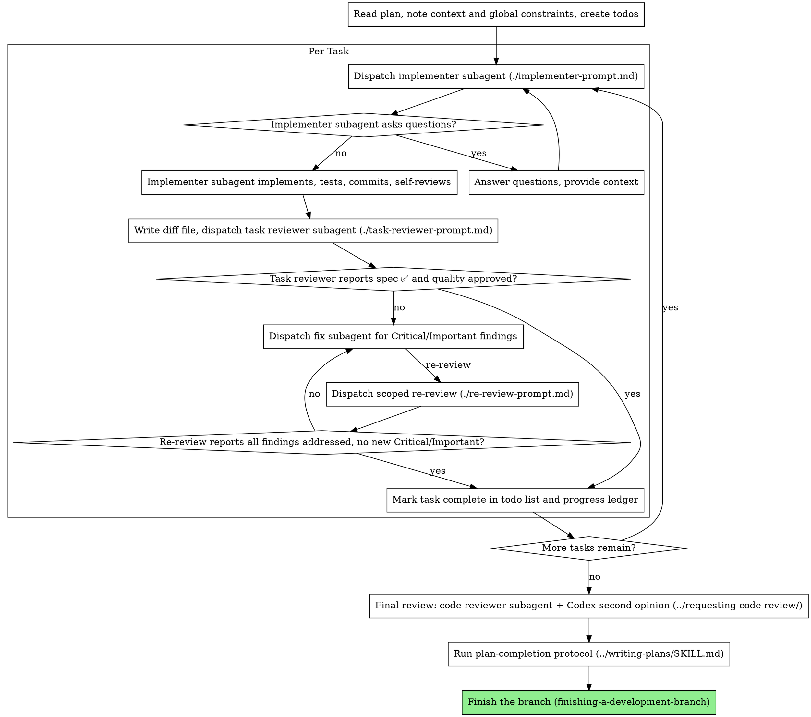

# Subagent-Driven Development

Execute plan by dispatching a fresh implementer subagent per task, a task review (spec compliance + code quality) after each, and a broad whole-branch review at the end.

**Why subagents:** You delegate tasks to specialized agents with isolated context. By precisely crafting their instructions and context, you ensure they stay focused and succeed at their task. They should never inherit your session's context or history — you construct exactly what they need, so dispatch each as the type its template names, never as a fork. This also preserves your own context for coordination work.

**Core principle:** Fresh subagent per task + task review (spec + quality) + broad final review = high quality, fast iteration

**Narration:** between tool calls, narrate at most one short line — the
ledger and the tool results carry the record.

**Continuous execution:** Do not pause to check in with your human partner between tasks. Execute tasks without stopping for permission. The only reasons to stop are: BLOCKED status you cannot resolve, ambiguity that genuinely prevents progress, a **context checkpoint** (see Context Checkpoints — a durable handoff to a fresh session, not a check-in), or all tasks complete. "Should I continue?" prompts and progress summaries waste their time — they asked you to execute the plan, so execute it.

**Start gate:** Start only on an explicit request to execute this plan: your human partner's choice of Subagent-Driven at writing-plans' handoff, or their own words ("execute the plan"). If you reached the plan any other way (you found the file, or another skill suggested it), ask once before the first dispatch: execution commits on the branch and spends on subagents. Once started, the no-check-in rule above holds.

## When to Use

You have an implementation plan whose tasks are mostly independent and you
are staying in this session. The decision graph and the trade-offs against
manual execution or a separate session:
[references/advantages.md](references/advantages.md).

## Red Flags

**Never:**
- Start implementation on main/master branch without explicit user consent
- Skip task review, or accept a report missing either verdict (spec compliance AND task quality are both required)
- Proceed with unfixed issues
- Dispatch multiple implementation subagents in parallel (conflicts)
- Make a subagent read the whole plan file (hand it its task brief —
  `scripts/task-brief` — instead)
- Skip scene-setting context (subagent needs to understand where task fits)
- Ignore a NEEDS_CONTEXT report (answer the questions and re-dispatch before moving on)
- Accept "close enough" on spec compliance (reviewer found spec issues = not done)
- Skip review loops (reviewer found issues = implementer fixes = review again)
- Let implementer self-review replace actual review (both are needed)
- Tell a reviewer what not to flag, or pre-rate a finding's severity — see **Constructing Reviewer Prompts**
- Dispatch a task reviewer without a diff file — generate it first
  (`<this-skill-dir>/scripts/review-package PLAN_FILE BASE HEAD`) and name the path it reports in
  the prompt, the path alone and not its whole summary line
- Move to next task while the review has open Critical/Important issues
- Re-dispatch a task the progress ledger already marks complete — check
  the ledger (and `git log`) after any compaction or resume

**If subagent reports NEEDS_CONTEXT:**
- Answer every question clearly and completely
- Re-dispatch with the same brief plus the answers
- Add the context the brief was missing so the second run can one-shot it

**If reviewer finds issues:**
- Dispatch a fix subagent with the findings — resumed or fresh per **Fix
  Rounds** (prompt per Constructing Reviewer Prompts)
- Exception: a fix confined to one file that changes no behavior (wording, a
  typo, a wrong name or path in prose or docs) you may make yourself. Commit it,
  append to the implementer's report file what you changed and that it changes
  no behavior, so no test covers it, then dispatch the scoped re-review as
  usual. A fix that changes what code does, even by one character, goes to a
  fix subagent, also when your partner asked you to fix small things yourself:
  tell your partner why, and dispatch the fix subagent in the same turn. A
  hand fix counts as one of the five attempts.
- Reviewer reviews again (scoped re-review, not a fresh full review — see Fix Rounds)
- Repeat up to the five-attempt cap, then adjudicate what's still open (see Fix Rounds)
- Don't skip the re-review

**If subagent fails task:**
- Dispatch a fix subagent with specific instructions — resumed or fresh per
  **Fix Rounds**
- Don't try to fix manually (context pollution); the one exception is the
  trivial reviewer finding above

## The Process

Every round loops back into the same fix-dispatch node above — the diagram
doesn't show the round cap or the resume-vs-fresh mechanic; see Fix Rounds.

**Batch small same-shape work.** Before you dispatch several small edits of the
same kind one by one, read [references/batching.md](references/batching.md).

## Pre-Flight Plan Review

Before the first dispatch, read [references/preflight.md](references/preflight.md)
and review the plan as it says.

## Model Selection

Pick the **cheapest tier that can one-shot the task without a re-loop** — but
on a genuine toss-up between two tiers, **err toward the stronger one.** The
signal order that picks the tier for a given task — risk, then the source of
the work, then spread — is in
[references/model-selection.md](references/model-selection.md); read it before
the first dispatch of a plan.

**Tiers** (each tier is its dispatch alias; the version behind an alias depends on your provider and settings):
- **cheap** — Haiku (dispatch alias `haiku`)
- **standard** — Sonnet (dispatch alias `sonnet`)
- **capable** — Opus (dispatch alias `opus`)

**Always specify the model explicitly when dispatching** — pass the tier's
dispatch alias (`haiku` / `sonnet` / `opus`), not the version ID, which the
dispatch tool's model parameter does not accept. An omitted model is never a
tier choice: on Claude Code a model-pinned agent runs at its pin, never
escalated, and any other agent inherits your session's model — usually the most
capable and most expensive; the Codex and Gemini adapters drop the pins, so
there every omission inherits. Either way it silently defeats this section.
On Claude Code, `hooks/dispatch-model-guard.py` (the agent-skills repo's) denies a dispatch with no model to an unpinned agent, once installed. It cannot tell when a pinned reviewer needed escalating: that choice stays yours.

When nothing clearly fires, default to **standard**. **Reviews** floor at
**standard** and scale up with the diff: a small mechanical diff reviews at
**standard**, a subtle or risky change at **capable**. The **final whole-branch
review is always capable** — dispatch it explicitly, not on the session default.

## Handling Implementer Status

Implementer subagents report one of four statuses. Handle each appropriately:

**DONE:** Generate the review package (`<this-skill-dir>/scripts/review-package PLAN_FILE BASE HEAD` — see **File Handoffs** for the BASE rule and for the path the script reports), then dispatch the task reviewer with that path.

**DONE_WITH_CONCERNS, NEEDS_CONTEXT or BLOCKED:** read
[references/handling-reports.md](references/handling-reports.md) when one arrives,
and handle it as that file says before any review.

## Handling Reviewer ⚠️ Items

When a reviewer marks an item ⚠️ because it could not verify it, read
[references/cannot-verify.md](references/cannot-verify.md) and resolve the item
as it says before you mark the task complete.

## Fix Rounds

A task gets at most **five fix attempts**; adjudication follows the fifth.
**Before every fix round, read [references/fix-loop.md](references/fix-loop.md)
again**, even when you remember it. Your memory of it does not survive
compaction, and it decides who fixes this round, how the re-review runs, and
when you stop to adjudicate. For an implementer already at **capable** whose
round 4 was a thorough attempt that still failed, where the runtime offers
`fable`: dispatch round 5 at `fable`. Where it does not, effort is the last rung.

## Plan Completion

When the last task's review resolves, read
[references/final-review.md](references/final-review.md) before you dispatch the
final whole-branch review. It holds the review's two seats, then the
plan-completion protocol and the workspace delete, in that order.

**A roadmap stage** (its plan header carries a `Roadmap:` line) runs the
protocol, step 3a included, before any merge, even when told to just merge, then
ends by the outcome of finishing-a-development-branch. Merged locally: "Stage N of
`<roadmap>` is merged. Next: /clear (or a fresh session), then resume the
roadmap: derive-roadmap on `<roadmap>`." Then stop. PR opened: "Resume the
roadmap once `<PR>` merges." Kept: "Stage N is complete on `<branch>` but
unmerged. Resume the roadmap after it merges." Discarded: no handoff, since
the stamp went with the branch. Even when asked to keep going, never resume
the roadmap here or plan, brainstorm or route to the next stage (step 3a's
Handoff bullets and stamp still name the stages they feed), and make no
model-tier claim. A stage this session finds already merged when it starts,
with the protocol not yet run, runs the protocol on the merged branch now.

## Constructing Reviewer Prompts

Per-task reviews are task-scoped gates. The broad review happens once, at the
final whole-branch review. When you fill a reviewer template:

- Do not add open-ended directives like "check all uses" or "run race tests
  if useful" without a concrete, task-specific reason
- Do not ask a reviewer to re-run tests the implementer already ran on the
  same code — the implementer's report carries the test evidence
- Do not pre-judge findings for the reviewer — never instruct a reviewer to
  ignore or not flag a specific issue. If you believe a finding would be a
  false positive, let the reviewer raise it and adjudicate it in the review
  loop. If the prompt you are writing contains "do not flag," "don't treat X
  as a defect," "not Important," or "the plan chose" — stop: you are
  pre-judging, usually to spare yourself a review loop.
- The global-constraints block you hand the reviewer is its attention
  lens. Copy the binding requirements verbatim from the plan's Global
  Constraints section or the spec: exact values, exact formats, and the
  stated relationships between components ("same layout as X", "matches
  Y"). The reviewer's template already carries the process rules (YAGNI,
  test hygiene, review method) — the constraints block is for what THIS
  project's spec demands.
- Hand the reviewer its diff as a file — see **File Handoffs** for the review-package contract.
- A dispatch prompt describes one task, not the session's history. Do not
  paste accumulated prior-task summaries ("state after Tasks 1-3") into
  later dispatches — a real session's dispatch hit 42k chars of which 99%
  was pasted history. A fresh subagent needs its task, the interfaces it
  touches, and the global constraints. Nothing else.
- Fix dispatches follow [references/fix-loop.md](references/fix-loop.md); the
  final whole-branch review follows [references/final-review.md](references/final-review.md).

## File Handoffs

Hand artifacts to subagents as files, never pasted into the prompt. Before your
first dispatch, read [references/file-handoffs.md](references/file-handoffs.md).

## Durable Progress

Conversation memory does not survive compaction. In real sessions,
controllers that lost their place have re-dispatched entire completed task
sequences — the single most expensive failure observed. Track progress in
a ledger file, not only in todos.

- At skill start, run `<this-skill-dir>/scripts/sdd-workspace <plan-file>`
  with no capture, so its printed directory shows. It creates this plan's
  workspace and the self-ignoring .gitignore that covers every plan's. Shell
  state does not persist across tool calls, so write that path out literally
  in every later command. Check for a ledger: `cat <path>/progress.md`. Tasks
  listed there as complete are DONE — do not re-dispatch them; resume at the
  first task not marked complete. After a `/clear` or relaunch, re-run the
  script to recover the path (it is idempotent). Pass the live plan path, or
  `specs/plans/completed/<file>` once the plan has retired.
- Resuming after a `/clear`, a relaunch or a compaction: read
  [references/resuming.md](references/resuming.md) before you dispatch anything.
- When you create the ledger, write its first line as
  `Plan: <plan-file-path>`. A workspace is named from the plan's basename, so
  two plans with the same basename in different directories would collide;
  this line is what makes that visible instead of silent.
- When a task's review comes back clean, append one line to the ledger in
  the same message as your other bookkeeping:
  `Task N: complete (commits <base7>..<head7>, review clean)`. Rule on its
  Declined to judge lines there too, one `Ruling:` line each, as
  [references/fix-loop.md](references/fix-loop.md) describes.
- The ledger is your recovery map: the commits it names exist in git even
  when your context no longer remembers creating them. After compaction,
  trust the ledger and `git log` over your own recollection.
- `git clean -fdx` will destroy the ledger (the `.sdd` parent's self-ignoring
  .gitignore keeps every plan's workspace out of git, but `-x` removes ignored
  files too); if that happens, recover from `git log`.

## Context Checkpoints

At a task boundary, when the harness signals context pressure (a compaction
warning, or context you notice has grown large), run the handoff in
[references/context-checkpoints.md](references/context-checkpoints.md). It is a
durable handoff, never a "should I continue?" check-in, and never interrupts a task.

## Prompt Templates

- [implementer-prompt.md](implementer-prompt.md) - Dispatch implementer subagent
- [task-reviewer-prompt.md](task-reviewer-prompt.md) - Dispatch task reviewer subagent (spec compliance + code quality)
- [re-review-prompt.md](re-review-prompt.md) - Dispatch a scoped re-review after fixes (per-finding ADDRESSED / NOT ADDRESSED)
- Final whole-branch review: use requesting-code-review's [code-reviewer.md](../requesting-code-review/code-reviewer.md), alongside its Codex second opinion, [codex-review.md](../requesting-code-review/codex-review.md)

## Example Workflow

One worked pass through the loop — a NEEDS_CONTEXT round-trip on Task 1, then a
failed spec review, a fix round and a scoped re-review on Task 2:
[references/example-workflow.md](references/example-workflow.md).

## Advantages

What this buys against manual execution and a separate parallel session, and
what it costs: [references/advantages.md](references/advantages.md).

## Integration

**Required workflow skills:**
- **using-git-worktrees** - Ensures isolated workspace (creates one or verifies existing)
- **writing-plans** - Creates the plan this skill executes
- **requesting-code-review** - Code review template and Codex second-opinion recipe for the final whole-branch review
- **finishing-a-development-branch** - Integrates the branch after the plan-completion protocol

**After all tasks:** run the plan-completion protocol, then use finishing-a-development-branch to integrate the branch (merge / PR / cleanup) and remove any worktree. For a roadmap stage, end with the resume handoff in Plan Completion.

**Subagents follow TDD** (red → green → refactor) for each task.

**Alternative:** for a separate parallel session instead of same-session execution, run the plan task-by-task in that session.
