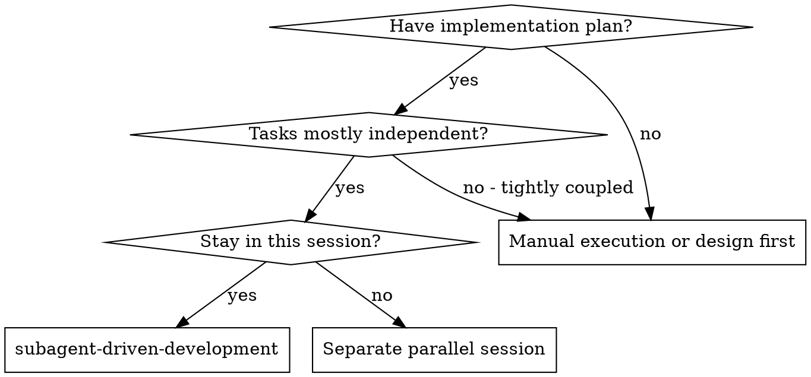

# Advantages and cost

What this skill buys against the two alternatives that § When to use, below,
weighs — manual execution and a separate parallel session — and what it costs.
Rationale for choosing the skill, not procedure for running it.

## When to use

## Trade-offs

**vs. Manual execution:**
- Subagents follow TDD naturally
- Fresh context per task (no confusion)
- Isolated context per dispatch (no cross-task contamination)
- Subagent can surface questions (a NEEDS_CONTEXT report; controller answers and re-dispatches)

**vs. Executing Plans:**
- Same session (no handoff)
- Continuous progress (no waiting)
- Review checkpoints automatic

**Efficiency gains:**
- Controller curates exactly what context is needed; bulk artifacts move
  as files, not pasted text
- Subagent gets complete information upfront
- Questions surfaced before work begins (not after)

**Quality gates:**
- Self-review catches issues before handoff
- Task review carries two verdicts: spec compliance and code quality
- Review loops ensure fixes actually work
- Spec compliance prevents over/under-building
- Code quality ensures implementation is well-built

**Cost:**
- More subagent invocations (implementer + reviewer per task)
- Controller does more prep work (extracting all tasks upfront)
- Review loops add iterations
- But catches issues early (cheaper than debugging later)
