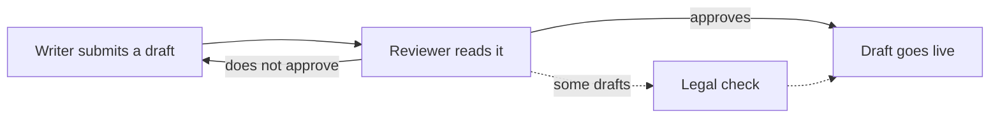

# Examples

Each pair shows one task, with made-up text.

## Write: a reply

Before:

> The heating schedule has been updated so that the thermostat will be switched to night mode at 22:00, and it should be noted that the old 23:00 setting has been kept in the backup file.

After:

> The thermostat now switches to night mode at 22:00. The backup file keeps the old 23:00 setting.

The rewrite uses the active voice, gives one idea in each sentence and drops the filler "it should be noted that".

## Labels

The review list says: D2, the upload page has no progress bar. D4, an upload above 20 MB fails.

Before:

> D4 is fixed, so only D2 is left.

After:

> The finding that an upload above 20 MB fails (D4) is fixed. Only the finding that the upload page has no progress bar (D2) is left.

Without the review list:

> D4 is fixed, so only D2 is left. I do not have the review list, so I cannot say what D2 and D4 are.

## Rewrite a text

Before:

> In order to make use of the thumbnail service, it is necessary for the image to be uploaded first, after which a thumbnail will be generated within about five seconds; however, very large images may take longer.

After:

> To use the thumbnail service, upload the image first. The service then makes a thumbnail in about five seconds. A very large image may take longer.

With "show the changes":

| Rule | Before | After |
|---|---|---|
| Plain words | In order to make use of | To use |
| Active voice | it is necessary for the image to be uploaded first | upload the image first |
| No semicolons | seconds; however, very large images may | seconds. A very large image may |

The hedge "may take longer" stays.

## Agent mode: a tool description

Before:

> The `render_thumbnail` tool is designed to seamlessly generate thumbnails for the images that have been uploaded by the user, and it can also optionally resize them if a width has been specified.

After:

> The `render_thumbnail` tool makes a thumbnail for each image that the user uploaded. If the request gives a width, the tool can also resize them to that width.
>
> Flag: "them" can mean the images or the thumbnails. The source does not say which.

The rewrite drops the marketing adjective "seamlessly" and keeps the identifier `render_thumbnail` unchanged. It flags the ambiguity and does not resolve it.

## Agent mode: an error string

Before:

> An error may have been encountered while reading `/etc/app/config.yaml`, which could possibly be due to missing permissions.

After:

> Reading `/etc/app/config.yaml` may have failed. Missing permissions may be the cause.
>
> Kept as-is: "may have failed", a compound tense that carries the hedge.

The path stays unchanged. The stacked hedge "could possibly" becomes one "may", at the same confidence.

## Agent mode: an instruction to another agent

Before:

> Once you are done checking the draft, go ahead and mark it as approved, unless there are blocking comments, in which case you should leave it as it is and post a note for the writer.

After:

> 1. Check the draft.
> 2. If the draft has blocking comments, you should leave it as it is and post a note for the writer.
> 3. If the draft has no blocking comments, mark it approved.

Each condition comes before its action. The source says "you should leave it", so step 2 keeps "should". A bare command would be stronger than the source.

## Strict STE: safety text

Before:

> CAUTION: Don't touch the heating plate till it's cooled down, or you'll get burned.

After:

> CAUTION: Do not touch the heating plate until it is cool. A hot plate can burn your skin.
>
> Not checked against the ASD-STE100 dictionary.

The signal word, the hazard, the consequence and the avoidance action all stay.

## Explain

Request: "Explain what `chmod 640 plan.txt` does."

> The command sets the permissions of `plan.txt`. The owner can read and write the file. The group can read the file. Other users have no access.

## Summarize

Source:

> The photo library backup failed on Tuesday and on Thursday. Both times, it stopped while it copied large videos. The team thinks that a full disk caused the failures, but nobody has confirmed this.

Summary in one sentence:

> The photo library backup failed on Tuesday and Thursday while it copied large videos, maybe because of a full disk, which nobody has confirmed.

## Diagram

Source:

> A writer submits a draft. A reviewer reads it. If the reviewer approves the draft, it goes live. If not, it goes back to the writer. Some drafts also get a legal check before they go live.

Text equivalent: the writer submits a draft, and the reviewer reads it. An approved draft goes live. A draft that is not approved goes back to the writer. Some drafts get a legal check before they go live (the dotted path).
