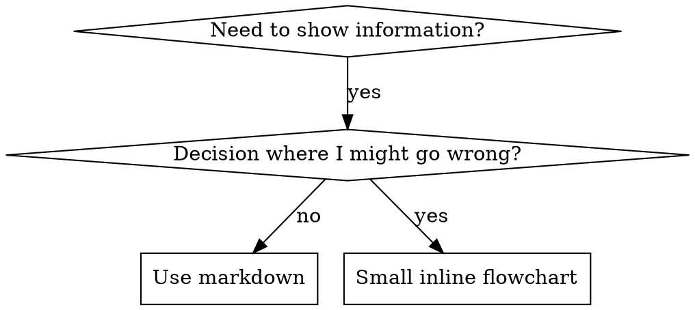

# Flowchart usage

Read this before you add a flowchart to a skill.



**Use flowcharts ONLY for:**
- Non-obvious decision points
- Process loops where you might stop too early
- "When to use A vs B" decisions

**Never use flowcharts for:**
- Reference material → Tables, lists
- Code examples → Markdown blocks
- Linear instructions → Numbered lists
- Labels without semantic meaning (step1, helper2)

See [graphviz-conventions.dot](graphviz-conventions.dot) for graphviz style rules.

**Visualizing for your human partner:** run [scripts/render_graphs.py](../scripts/render_graphs.py) to render a skill's flowcharts to SVG. It reads every Markdown file in the skill, skips a `dot` block with no graph header, and exits non-zero when a block fails. It needs Graphviz's `dot` on PATH. Give it an output folder outside the skill, since everything in the skill folder ships with the skill. From writing-skills' directory:
```bash
uv run scripts/render_graphs.py ../some-skill /tmp/some-skill-diagrams           # Each diagram separately
uv run scripts/render_graphs.py ../some-skill /tmp/some-skill-diagrams --combine # All diagrams in one SVG
```
